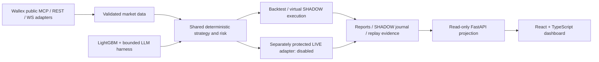

# Wallex QuantPilot

An explainable, AI-assisted spot trading research system for a three-day competition.
One Python Trading Core supplies deterministic strategy, risk and portfolio logic to
backtesting, virtual SHADOW operation and separately protected execution.

**Phase 8 delivery:** React + TypeScript dashboard, a read-only FastAPI reporting API,
competition report exports and Docker Compose startup. **LIVE stays disabled.**
No exchange orders, private account calls or real credentials were used for this phase.

## Quick start - local dashboard

Python 3.11+ and Node 22 are recommended for the commands below. Run from the repository root.
The existing reference `FinanceAgent-master` is not required and must not be executed.

```powershell
py -3.13 -m venv .venv
.venv\Scripts\python.exe -m pip install -e ".[dev,marketdata,ai,dashboard]"
npm.cmd ci --ignore-scripts
```

Terminal 1:

```powershell
.venv\Scripts\python.exe -m uvicorn quantpilot.dashboard.api:app --host 127.0.0.1 --port 8000
```

Terminal 2:

```powershell
npm.cmd run dev
```

Open **http://127.0.0.1:5173**. On Unix, use `.venv/bin/python` and `npm`.
No API key, LLM provider or exchange access is needed for the default UI demonstration.
The legacy UI and API sources remain available separately; they are not mounted into the new API.

## Docker Compose - complete read-only application

```powershell
New-Item -ItemType Directory -Force data/dashboard | Out-Null
docker compose up --build
```

Open **http://127.0.0.1:8080**. Compose starts the FastAPI and Nginx/React services.
API readiness is checked before the web service starts. The application network is
internal, reports are mounted read-only and no trading credentials are passed in.
The UI initially shows the clearly labeled **SIMULATED** dataset. Dependency/image
installation needs internet; the built default demo runs without exchange access.

```powershell
docker compose down
```

The pre-existing PostgreSQL/collector services remain behind the `marketdata` profile;
the Phase 1 offline engine demo is behind `tools`. Neither is needed to view the dashboard.
Docker was not installed in the implementation environment: the configuration was inspected
and parsed, but container build/startup is **not verified**. Native UI/API startup was verified.

## Offline demonstration - UI versus actual core execution

The default `DEMO` view contains illustrative UI values. It is **not** a strategy backtest.
Every section and download keeps the simulation label. These values are never substituted
for a missing recorded run.

For a synthetic SHADOW rehearsal that really exercises the existing Trading Core:

```powershell
.venv\Scripts\python.exe -m quantpilot.dashboard.offline --root data/dashboard
```

Select **SHADOW - Synthetic core rehearsal**. This creates three fixture frames and a
virtual portfolio, without any network, model-provider or exchange calls. Its source
label says **VIRTUAL - Simulated-market SHADOW**. Re-running into the same database is
rejected; preserve the existing evidence and use a different root for another rehearsal.

For an actual synthetic baseline backtest and optional cost sensitivities:

```powershell
.venv\Scripts\python.exe -m quantpilot.backtest.cli --output data/dashboard/baseline --sensitivity
```

For a **new** catalog, copy `config/dashboard.catalog.example.json` to
`data/dashboard/catalog.json`. If a catalog already exists, add the example `baseline`
entry to its `runs` list instead of overwriting it. The example `shadow` entry becomes
available only after the public-feed SHADOW demonstration below is started.
`--input history.json` selects your validated historical dataset instead of synthetic history.
No historical order books are fabricated from candles; see [execution assumptions](docs/phase4.md).

## Public Wallex SHADOW demonstration - virtual money only

Review the public market constraints in `docs/examples/shadow-quant.example.json` first;
they are example settings, not a current exchange-permission verification. This baseline
mode intentionally uses **QUANT_ONLY**, so no model/key/provider is silently substituted.

```powershell
.venv\Scripts\python.exe -m quantpilot.shadow.cli start --config docs/examples/shadow-quant.example.json --db data/dashboard/shadow/session.sqlite --responses data/dashboard/shadow/responses
```

In another terminal:

```powershell
.venv\Scripts\python.exe -m quantpilot.shadow.cli health --db data/dashboard/shadow/session.sqlite
.venv\Scripts\python.exe -m quantpilot.shadow.cli portfolio --db data/dashboard/shadow/session.sqlite
.venv\Scripts\python.exe -m quantpilot.shadow.cli stop --db data/dashboard/shadow/session.sqlite
```

The catalog's `shadow` entry reads this database through a consistent **read-only**
SQLite transaction. The dashboard refreshes every 10 seconds, displays the writer lease,
recorded latency and freshness, and never claims a permanent MCP/WebSocket connection.
No credentials are needed. Initial candle warmup can take time; failures remain visible.

For hybrid SHADOW use [the Phase 6 configuration](docs/phase6.md), a compatible frozen
LightGBM artifact and recorded analyst responses. Real analyst calls need their own
explicit provider configuration; never give the analyst Wallex credentials or order tools.
AI benefit is not established by the synthetic demo.

Export decision counts and rejection reasons from an existing SHADOW journal:

```powershell
.venv\Scripts\python.exe -m quantpilot.diagnostics --shadow-db data/dashboard/shadow/session.sqlite --output data/dashboard/decision-diagnostics.json
```

This command is read-only and makes no exchange calls. See the
[trading blocker investigation](docs/TRADING_BLOCKER_REPORT.md) for historical,
public-feed and synthetic execution evidence and the limits of each result.

The SHADOW CLI now reads its five dedicated LLM settings from `.env`; process
environment takes precedence, followed by `.env`, then JSON. Real calls still
require `--allow-llm-network` and a hybrid JSON configuration. See
[LLM environment setup](docs/LLM_ENV.md) for the supported gateway contract and flags.

## Decision replay

Replay the offline rehearsal (or replace its database path with the observed session):

```powershell
.venv\Scripts\python.exe -m quantpilot.shadow.cli replay --db data/dashboard/offline-shadow/session.sqlite --responses data/dashboard/offline-shadow/responses --output data/dashboard/replay.json
```

Add `"replay": "replay.json"` to the corresponding catalog entry to display the result.
The dashboard labels it **REPORTED MATCH/DIVERGED**; the API does not execute replay.
Replay itself verifies source/config/model identities, decisions and state hashes,
uses recorded analyst outcomes and makes no LLM network calls. Phase 8 verification
reproduced all three offline frames with **MATCH**.

## Report generation and evidence catalog

Use the dashboard's **Competition Report** or **Testing** downloads for Markdown,
JSON and CSV. Offline CLI equivalent:

```powershell
.venv\Scripts\python.exe -m quantpilot.dashboard.cli --root data/dashboard --run demo --output data/dashboard/judge-demo
.venv\Scripts\python.exe -m quantpilot.dashboard.cli --root data/dashboard --run offline-shadow --output data/dashboard/judge-shadow
```

Output directories must not already contain report files. Reports preserve mode,
source label, exact Decimal strings, observed-day activity, risks and evidence limitations.
They are **provisional**, not final-liquidation or competition-score certification.

The optional `data/dashboard/catalog.json` contains only explicitly approved local sources:

```json
{
  "runs": [
    {"id":"baseline","title":"Recorded baseline","kind":"BACKTEST","path":"baseline/report.json"},
    {"id":"shadow","title":"Virtual session","kind":"SHADOW","path":"shadow/session.sqlite"}
  ]
}
```

Paths resolve within the dashboard root. A SHADOW export directory from
`quantpilot.shadow.cli export` also works. Optional `replay`, `comparison`, `health`
and `analyst_traces` paths refer to explicitly exported JSON artifacts in the same root.
`comparison` expects Phase 5 `ai-evaluation.json`; `analyst_traces` links prompt/model
versions by exact recorded trace ID. Unmatched or missing information stays unavailable.
A comparison is separate historical evaluation evidence, not the selected account's return.

To generate the existing reproducible synthetic Quant / Quant+ML / Quant+ML+LLM evaluation:

```powershell
.venv\Scripts\python.exe -m quantpilot.ai.cli demo --output data/dashboard/ai-evaluation
```

Attach `ai-evaluation/ai-evaluation.json` as a catalog `comparison` path. This is
research-only, uses fixture analyst responses and does not establish real model efficacy.

## System architecture



The UI has eight sections: Overview, Market Monitor, AI Analysis, Orders, Performance,
Testing, System Health and Competition Report. Financial calculations stay in Python
using Decimal and explicit TMN units; JavaScript numbers only draw/format the display.
The dashboard API exposes no order, withdrawal, activation or circuit-breaker reset route.
See [SPEC.md](SPEC.md), [architecture](docs/architecture.md) and [Phase 8 details](docs/phase8.md).

## Verification

```powershell
.venv\Scripts\python.exe -m pytest -q
.venv\Scripts\python.exe -m ruff check src/quantpilot tests
.venv\Scripts\python.exe -m mypy
npm.cmd test
npm.cmd run build
```

[Phase 8 verification and remaining limitations](docs/PHASE8_VERIFICATION.md) records
actual results. The optional PostgreSQL integration test needs a separately configured
local server and explicit opt-in. No test uses real trading credentials or orders.

## Important limits

- DEMO is illustrative, BACKTEST is simulated, SHADOW uses virtual accounting, and
  LIVE exports are operator-provided records, not independently exchange-authenticated.
- LIVE exports lack complete certified initial-capital/PnL/fee information; those
  aggregate metrics remain unavailable. No values are inferred from the first equity sample.
- Missing per-order API latency and prompt versions are not guessed. WebSocket is
  not used by the current SHADOW poller; archived connections are not current liveness.
- Charts are sampled to at most 2,000 points. Full loaded-history Decimal metrics
  and daily totals are computed before sampling; tables show bounded recent activity.
- Source files/history are bounded for local operation. Large sessions may require
  offline aggregation. SQLite/WAL permissions must allow consistent read-only access.
- No multi-user authentication is provided. Keep the dashboard bound to localhost;
  financial exports can be sensitive even without credentials.
- Existing LIVE implementation fingerprints deliberately reject code changes on restart.
  Do not clear journal fingerprints to bypass migration review after installing Phase 8.
- Protected LIVE remains limited to reviewed MAIN_SPOT/TMN LIMIT execution. Competition
  credit routing and permissions are unresolved. See the separate
  [LIVE activation checklist](docs/LIVE_ACTIVATION_CHECKLIST.md).

**Stop after Phase 8. No live trading was activated.**

Historical UI/API setup notes are preserved in [docs/legacy-README.md](docs/legacy-README.md).
