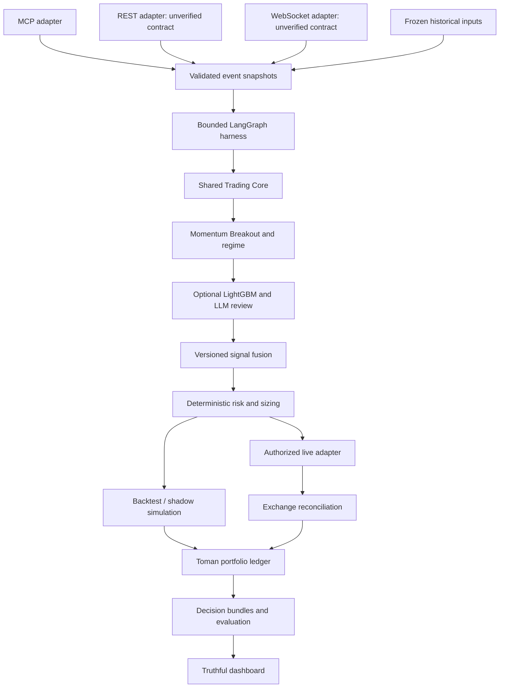

# Architecture and gap analysis

## Continuous operation correction

Execution transport (BACKTEST/SHADOW/LIVE) and operating profile
(CONTINUOUS/COMPETITION) are independent. `profiles.ProfileConfig` supplies the
shared timing policy to each existing configuration, without a second strategy
or engine. CONTINUOUS has no deadline and no terminal sell. COMPETITION opts
into start/cutoff/deadline and optional liquidation. Old configs containing a
deadline infer competition behavior; explicit continuous timing is rejected.

`trading.sizing.AdaptivePositionSizer` contains the time-independent quantity
kernel. The existing deterministic Risk Engine supplies fee-aware loss budget,
free funds, reserved risk/exposure, volatility-derived stop distance and actual
depth. Equity percentage and optional absolute caps constrain the result;
existing regime eligibility and AI vetoes remain unchanged. No unvalidated AI
confidence multiplier increases size. All paths retain the common Spot guard.

Protected execution journals lifecycle controls alongside existing durable orders
and portfolio state. Restart resets lifecycle to STARTING, never auto-resumes.
Explicit resume requires fresh reconciliation, known orders, authorization and
unlatched risk/kill checks. Stop-new-entries permits reductions; pause blocks
ordinary submission; graceful close releases resources without liquidation.
Existing SHADOW runner remains an unbounded public-data polling loop unless
explicitly stopped, with its existing checkpoint recovery/reconnect behavior.

This is a configuration/core migration, not live deployment certification.
Authorization still expires; continuous operation must stop submitting until
authorization is renewed. Credit LIVE support is not enabled by this change.

Phase 8 update: `quantpilot.dashboard` projects catalog-approved backtest reports,
consistent read-only SHADOW checkpoints/exports, recorded AI/replay evidence and
operator-provided LIVE audit exports. FastAPI exposes only read endpoints; no
execution adapter, Wallex key, runner control or LLM provider is injected. The
React/TypeScript UI renders the eight judge-facing sections with persistent mode
and provenance labels. Nginx/Compose serve the UI/API on localhost; the original
core, legacy source and simulation/AI/SHADOW implementations remain intact.
See [Phase 8](phase8.md), [verification](PHASE8_VERIFICATION.md) and [README](../README.md).

Phase 7 update: `quantpilot.live` implements the ExecutionProvider port behind
explicit account/config/credential authorization and fresh same-core risk checks.
A dedicated single-writer journal commits intent before POST and reconciles ambiguous
outcomes with GET only. Actual cumulative fills update positions atomically;
balance/open-order/metadata disagreement suspends execution. Kill, drawdown/daily
loss and deadline liquidation policies are deterministic. Raw transport mutations
are disabled unless the protected factory supplies durable-send authorization.
SHADOW and the LLM never receive this transport. Supported deployment envelope
and unverified account/credit/settlement contracts: [Phase 7](phase7.md).

Phase 6 update: `quantpilot.shadow` adds a keyless public feed, strict transport/
operation guards, fresh-book virtual execution, transactional SQLite inbox and
ledger/order checkpoints, a writer lease, local read-only health and CLI controls.
The same deterministic frame reducer drives observation and journal replay using
unchanged quant/risk/AI/portfolio components. Recorded analyst failures are replay
evidence as well as successful responses. See [Phase 6](phase6.md).

Phase 5 update: `quantpilot.ai` provides eligible-signal labeling, purged splits,
LightGBM training/calibration/frozen inference, independent LLM context/provider/
cache harness, and structured veto-only fusion through the existing SignalEvaluator
port. HistoricalReplay accepts this optional entry filter and a holdout start;
canonical strategy signals still reach unchanged deterministic risk last. AI
cannot suppress SELL exits. Model/cache/trace artifacts are distinct from the
financial ledger. See [Phase 5](phase5.md) and its synthetic evaluation report.

Phase 4 update: `quantpilot.backtest` injects a HistoricalClock and point-in-time
HistoricalMarketDataProvider around the unchanged Phase 3 Strategy/Risk engines.
Approved intents go to SimulatedExecutionProvider, then a Decimal multi-currency
PortfolioLedger. HistoricalReplay coordinates close/decision/open events and
terminal liquidation. JSON/CSV reports include accounting, decisions, equity and
replay hashes. See [Phase 4](phase4.md) for execution assumptions and limitations.
The original gap table below is the retained Phase 0 baseline.

Phase 3 update: `src/quantpilot/trading` adds configurable Decimal features, past-only
multi-timeframe resampling, regime/eligibility rules, Momentum Breakout, deterministic
risk and simulated position transitions. These implement the existing Strategy and
RiskManager ports. See [Phase 3](phase3.md) for defaults, formulas and boundaries.
No exchange executor or model was introduced; historical gap tables remain the
Phase 0 audit baseline rather than current implementation status.

Phase 2 public-data adapter implementation now lives in `src/quantpilot/marketdata`:
typed normalization, collectors, public-only MCP/REST/WebSocket transports, Parquet
storage and PostgreSQL catalog. See [Phase 2](phase2.md) for verified capabilities
and limitations. Core interfaces remain transport-independent. Earlier gap tables
below are the Phase 0 baseline, not a claim that Phase 2 work is absent.

Phase 1 update: an additive shared Python skeleton now exists in `src/quantpilot`.
See [Phase 1 implementation](phase1.md) for contracts, packaging, offline wiring,
configuration and safety boundaries. Existing backend paths below remain unchanged;
the new core is not yet integrated into those routes. Target capabilities in this
document must not be interpreted as completed by the skeleton.

Authority: ../SPEC.md. Labels and status evidence: current-state-audit.md. Everything in the target diagram is proposed unless explicitly marked current.

## Current flow

React polling → FastAPI → explicit MarketDataService → MCP per-call session.
Signal routes → TradingAgent StateGraph → memory context → candles tool → baseline strategy → analysis_only marker → audit event. AsyncSqliteSaver persists state to a separate file. Order route is outside the graph and rejects requests; even live flags result in 501 rather than submission.

## Target flow

## Component-by-component gaps

| Target | Current evidence | Migration |
|---|---|---|
| Shared Trading Core | strategy function reusable but clock/config/float coupled; no ledger | extract domain contracts then preserve baseline through adapter |
| BACKTEST/SHADOW/LIVE | strings and rejected orders only | implement mode-specific clocks/adapters around same core |
| MCP | working narrow path by supplied outputs; client/role mapping reusable | add typed response contracts, timeouts, schema type validation, tool pagination |
| REST/WebSocket | missing direct adapters; HTTP MCP is not REST market integration | verify official contracts before coding |
| Momentum Breakout | only proposal; independent imported reference functions | implement version separately, keep baseline comparison |
| Regime | missing explicit classification | versioned deterministic rules |
| LightGBM | missing dependencies/model/artifacts | evaluate only after historical dataset and baseline harness |
| LLM Analyst | imported demo only, absent in application | bounded review node once provider is configured |
| Harness | StateGraph works on synthetic input; no model selection or scheduler | retain graph, add explicit bounded orchestration later |
| Fusion | missing | explicit rules, abstention and ablation evidence |
| Risk | denylist and schema literals, configuration mostly unused | standalone mandatory deterministic gate |
| Simulation/live execution | missing; route correctly fails closed | retain rejection behavior until promotion gates pass |
| Toman portfolio | missing | multi-currency Decimal ledger and conversion provenance |
| Audit/replay | audit+checkpoints exist; no replay service or input manifest | retain records; add versioned bundles/clock/hash contracts |
| Final liquidation | missing | idempotent deadline state machine with reconciliation |
| Dashboard/reports | UI partial with static chart; reports missing | retain layout/API proxy, replace mock claims only with real ledger data |

## Incompatibilities and boundaries

- Backend loads denylist by parsing frontend JavaScript: retain data but migrate to a neutral versioned resource with parity check.
- Baseline sizing treats max_order_quote as capital and ignores quote currency, fees and account holdings; it cannot be promoted directly to LIVE.
- Agent calls strategy without held_base, so current public analysis flow cannot sell held assets. Reconcile account/positions before using SELL semantics.
- Timestamp is wall time; confidence is heuristic; callbacks use fresh UUIDs; replay requires injected time, stable decision keys and recorded model results.
- UI GET polling creates new decisions/checkpoints and remains active after local stop button; move observation scheduling to a backend runner and make dashboard reads side-effect-free in a later phase.
- Imported FinanceAgent is reference material: synthetic holdings/prices, no checkpoint, detached indicators, hardcoded external credential and narrative output. Do not merge wholesale.

## Migration recommendation: B

Gradually refactor existing modules. A full continuation without boundaries preserves financial correctness gaps; a clean rewrite would discard a proven narrow data path and useful audit/UI components without evidence of necessity.

Retain backend/mcp_client.py, market_data.py, agent.py, memory.py, market_rules.py and its 344-pair data, config.py, schemas.py, strategy.py as baseline, main.py API/entrypoint, src layout/styles and vite.config.js. Each needs the bounded changes identified in the plan. Preserve FinanceAgent-master and archive unchanged as reference; do not import into runtime. Preserve existing data files; schema changes require backup and additive versioned migrations. Existing docs remain available but SPEC.md supersedes conflicting claims.

## Spot-only enforcement amendment ? 2026-10-23

`quantpilot.spot` supplies the permanent `SpotPolicy` and a pure shared wallet/order guard.
Strategy -> optional AI veto -> canonical deterministic risk -> mode-specific execution
remains the architecture. Risk and BACKTEST/SHADOW/LIVE boundaries call the same guard;
mode-specific protections remain stricter where necessary (LIVE base-fee reserve, LIMIT,
reconciliation and separate authorization). No business logic imports Wallex transports.

Money remains Decimal; free and reserved balances are separate. The existing average-cost
ledger, fill transitions, partial fills and event/replay journals are reused. The strategy
adds an ownership consistency HOLD without changing breakout/regime calculations. The
legacy MCP boundary now rejects all mutations and non-allowlisted tools before connecting.
The packaged public MCP transport already has a separate verified read-only allowlist.

SHADOW optional deadline orchestration cancels entries before processing fills, queues
reduce-only sales, and records liquidation actions plus cash/residual status in each frame.
Later books alone confirm simulated asset-sale fills. FX settlement has explicit route,
precision, fee and bid-depth constraints. BACKTEST terminal FX conversion no longer treats
an FX rate as an executable order. LIVE settlement accounting is a read-only projection of
reconciled balances and verified journal fills, and does not create a trading scheduler.

Prompt version is `analyst-v2-spot`. Artifact implementation hashes now include `spot.py`.
Source/config/prompt changes deliberately prevent silent replay/inference with old identities;
see SPEC compatibility notes before using existing artifacts or journals.
